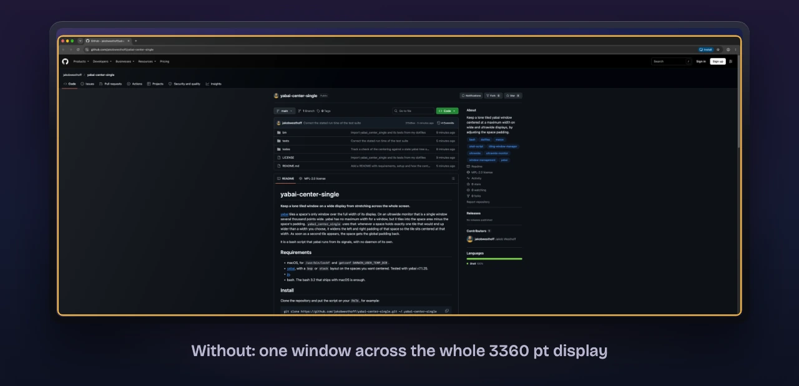

<p align="center">
  
</p>

# yabai-center-single

**Keep a lone tiled window on a wide display from stretching across the
whole screen.**

[yabai](https://github.com/asmvik/yabai) tiles a space's only window over
the full width of its display. On an ultrawide monitor that is a single
window several thousand points wide. yabai has no maximum width for a
window, but it tiles into the space area minus the space's padding.
`yabai_center_single` uses that: whenever a space holds exactly one tile
that would end up wider than a width you choose, it widens the left and
right padding of that space so the tile sits centered at that width. As
soon as a second tile appears, the space gets the global padding back.

It is a bash script that yabai runs from its signals, with no daemon of
its own.

## Requirements

- macOS, for `/usr/bin/lockf` and `getconf DARWIN_USER_TEMP_DIR`.
- [yabai](https://github.com/asmvik/yabai), with a `bsp` or `stack`
  layout on the spaces you want centered. Tested with yabai v7.1.25.
- [jq](https://jqlang.org).
- bash. The bash 3.2 that ships with macOS is enough.

## Install

Clone the repository and put the script on your `PATH`, for example:

    git clone https://github.com/jakobwesthoff/yabai-center-single.git ~/.yabai-center-single
    ln -s ~/.yabai-center-single/bin/yabai_center_single ~/bin/yabai_center_single

## Setup

Register the script for yabai's window and space signals in your
`yabairc`, and run it once at the end:

```sh
single_window_max_width=2080
center_single="$HOME/bin/yabai_center_single"

for event in window_created window_destroyed window_minimized window_deminimized \
             window_resized application_hidden application_visible space_changed \
             mission_control_exit display_added display_removed display_resized \
             window_focused application_front_switched system_woke; do
    yabai -m signal --add event="$event" label="center_single_$event" \
        action="$center_single $single_window_max_width"
done
"$center_single" "$single_window_max_width" &
```

`single_window_max_width` is the width of a centered tile, in points, the
unit yabai uses for every frame and padding. The labels make a reload of
your `yabairc` replace the signals instead of adding them a second time.

Every change in the number of tiles on a space resizes some tiled window,
so `window_resized` also covers changes that have no signal of their own,
such as a window dropped onto another display or sent to another space.
`window_focused`, `application_front_switched` and `system_woke` change no
layout. They make a padding that the other signals left wrong last only
until the next change of focus. A run that finds every padding right
writes nothing.

The action has to end in `yabai_center_single <width>`, because
`yabai_center_single refresh` reads the width back from the registered
signals.

Floating the only tiled window of a space resizes no other window, so no
signal arrives. If you toggle floating with a key binding, run `refresh`
after it, for example in `skhdrc`:

```sh
ctrl + alt - t : yabai -m window --toggle float; yabai_center_single refresh
```

## Usage

    yabai_center_single <max-width>    center lone tiled windows at <max-width>
    yabai_center_single refresh        the same, with <max-width> from the yabairc signals
    yabai_center_single pause [space]  stop all padding changes until resume
    yabai_center_single resume         restore the paused space's padding, center again

The script owns the left and right padding of every tiling space. A value
set by hand is overwritten by the next window event. To keep one, for
example while a tool sets its own padding on a space, run `pause` with
that space first. `resume` puts the global padding back on the paused
space and centers again.

## How it works

On every run, the script asks yabai for its spaces and displays.
`yabai -m query --spaces` reports the window of the first and of the last
leaf of each space's tree, and the two being the same window means a
single tile. A stack, whether a `stack` layout space or stacked windows in
one node, counts as one tile, since it shows one window at a time.

For a space with a single tile whose display is wider than
`<max-width>` plus the global left and right padding, the side padding
becomes half of the display width minus `<max-width>`, rounded up, and
never less than the global padding. Every other space gets the global left
and right padding. `float` spaces and native fullscreen spaces are left
alone. The display width is the full display frame, so a Dock on the left
or right edge of a wide display makes a centered tile narrower than
`<max-width>`. On a display too narrow to produce a tile wider than
`<max-width>`, no space is centered.

Only a padding that differs from the current one is written, as every
write makes yabai lay out the space again. Spaces that are not visible
are written too, and yabai applies their padding when they become
visible.

yabai starts one process per signal without waiting for any of them, and
`window_resized` arrives in bursts. Each process first leaves a mark and
then tries to take a lock. The one that gets it passes over all spaces
until a pass ends with no mark left; every other process exits at once.
A pass that fails, because yabai could not answer or a padding write was
refused, is repeated after a second, up to five times in a row.

## Logs

A run that gives up after five failed passes, a pass that is still
running after 3 s and every 30 s after that, and a pass that took 3 s or
more are logged with a timestamp to
`~/Library/Logs/yabai_center_single.log`. When you run the script in a
terminal, the same lines appear there.

## Tests

    tests/yabai_center_single.sh

The tests run the script against a fake yabai and need
[jq](https://jqlang.org) and [ripgrep](https://github.com/BurntSushi/ripgrep).
They take under a minute, most of it spent in a test that holds a pass
for 11 s and in the one-second waits between retries.

## License

[Mozilla Public License 2.0](LICENSE)
